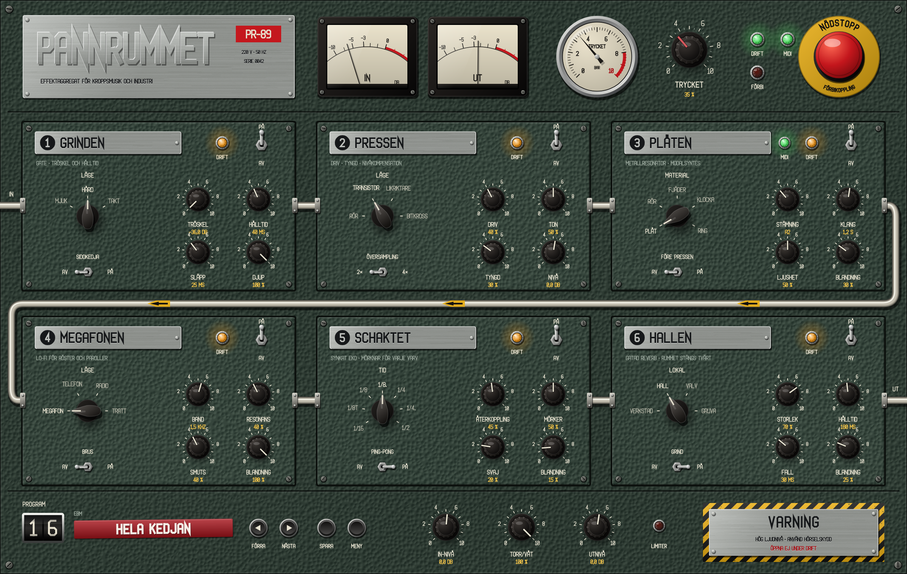

# Pannrummet

*Modell PR-89.* Ett effektaggregat för EBM och industri: sex moduler i en fast kedja – **Grinden**, **Pressen**, **Plåten**, **Megafonen**, **Schaktet** och **Hallen** – med makrospaken **Trycket** och ett **nödstopp**. Effektplugin (VST3, AU, CLAP) med MIDI-ingång, för macOS. Syster till [Kroppsmaskinen](../kropps-maskinen).

**Status: 1.0 – fas 0–3 klara och alla grindar godkända (5 november 2026).** Använd VST3 (eller CLAP) i Reaper. Se [PLAN.md](PLAN.md).



## Manualer

- **[Manualen](docs/Manual.md)** – snabbstart, varje modul och reglage med bilder, Trycket, programmen, recept och felsökning.
- **[Pannrummet i Reaper](docs/Pannrummet_i_Reaper.md)** – insert, sidokedja, MIDI till Plåten, automation och testlåten.

**Kom igång:** lägg Pannrummet (VST3) på ett spår, klicka på den röda remsan nederst till vänster och välj ett program i rätt kategori, och vrid på **TRYCKET**.

## Kedjan

```
IN ─▶ 1 GRINDEN ─▶ 2 PRESSEN ─▶ 3 PLÅTEN ─▶ 4 MEGAFONEN ─▶ 5 SCHAKTET ─▶ 6 HALLEN ─▶ TORR/VÅT ─▶ UTNIVÅ ─▶ LIMITER ─▶ UT
```

Plåtens brytare *Före Pressen* byter plats på 2 och 3. Varje modul har en huvudbrytare (**PÅ/AV**) och en **DRIFT**-lampa. En avstängd modul räknar inte.

| Modul | Väljaren | Rattarna | Brytaren |
| --- | --- | --- | --- |
| **1 Grinden** | **MJUK** (vanlig gate), **HÅRD** (stänger tvärt), **TAKT** (öppnar på valda sextondelar i DAW:ens takt) | Tröskel, Hålltid, Släpp, Djup | **Sidokedja**: pluginets andra ingång styr grinden. I TAKT visas i stället **taktstegen** – 16 knappar, klick tänder och släcker. DRIFT-lampan lyser starkare när grinden är öppen. |
| **2 Pressen** | **RÖR**, **TRANSISTOR**, **LIKRIKTARE** (oktav upp och smuts), **BITKROSS** | Driv, Ton (tilt), Tyngd (kompression före drivet), Nivå | **Översampling** 2× / 4×. Nivån kompenseras automatiskt: Driv ändrar karaktären, inte volymen. |
| **3 Plåten** | **PLÅT**, **RÖR**, **FJÄDER**, **KLOCKA** (stämda resonatorer som ljudet slår an), **RING** (ringmodulator) | Stämning, Klang (efterklang), Ljushet, Blandning | Före Pressen. **MIDI**-lampan: tänd = senaste MIDI-ton stämmer Plåten. |
| **4 Megafonen** | **MEGAFON**, **TELEFON**, **RADIO**, **TRATT** | Band (mittfrekvens), Resonans, Smuts, Blandning | **Brus**: ledningsbrus och sprak. |
| **5 Schaktet** | Tid 1/16 – 1/2 i DAW:ens tempo | Återkoppling, Mörker (varje varv mörkare), Svaj, Blandning | Ping-pong. |
| **6 Hallen** | **VERKSTAD**, **HALL**, **VALV**, **GRUVA** | Storlek, Hålltid, Fall, Blandning | **Grind**: rummet stängs tvärt Hålltid efter ljudet, på Fall. Av: rummet klingar ut. |

Överst: **IN** och **UT** (visarinstrument), **TRYCKET** (ratten eller manometern: drar alla påslagna moduler mot mer – hårdare grind, mer driv, mer metall, smutsigare megafon, längre eko, större hall), **DRIFT/FÖRBI**, **MIDI** (MIDI in för hela Pannrummet – av från början, se nedan) och **NÖDSTOPPET** – klicka på svampen för att koppla förbi allt (mjuk övertoning, bitexakt förbikoppling). DAW:ens bypass-knapp är samma sak.

Nederst: **PROGRAM** (se nedan), **MENY** (storlek 60–160 % och mappen med egna program), **IN-NIVÅ**, **TORR/VÅT**, **UTNIVÅ** och **LIMITER**-lampan (lyser när limitern tar i; klicka för att stänga av limitern).

Reglagen: rattar dras upp/ned (Skift = fint), rullas, dubbelklick ger grundvärdet. Vridomkopplare: klick = nästa, Skift-klick = förra, rulla, högerklick = lista. Brytare, steg och lampor: klick.

Allt om reglagen står i [manualen](docs/Manual.md), och hur sidokedjan, MIDI och automationen används i Reaper i [Pannrummet i Reaper](docs/Pannrummet_i_Reaper.md).

## Grind 1 och 2 – lyssna

`renders/grind1/` har exemplen, i fas med originalen (latensen borttagen), för A/B mot Kroppsmaskinens renders:

| Fil | In | Inställning |
| --- | --- | --- |
| `1a_trummor_grind_hard_press.wav` | `grind0_kolv125_trummor.wav` | Grinden HÅRD, Pressen TRANSISTOR med tyngd |
| `1b_helmix_grind_takt.wav` | `grind1_ebm_128.wav` | Grinden TAKT (hackar hela mixen i ett mönster), Pressen RÖR |
| `2a_bas_press_ror.wav` | `grind0_kolv125_bas.wav` | Pressen RÖR |
| `2b_bas_press_likriktare.wav` | `grind0_kolv125_bas.wav` | Pressen LIKRIKTARE, 4× |
| `2c_bas_press_bitkross.wav` | `grind0_kolv125_bas.wav` | Pressen BITKROSS, 60 % våt |
| `3a`–`3d_rost_*.wav` | `3_rost_torr.wav` (talsyntes) | Megafonen i alla fyra lägen, TRATT med Pressen |

`renders/grind2/`:

| Fil | In | Inställning |
| --- | --- | --- |
| `4a_trummor_platen_plat.wav` | trummorna | Plåten PLÅT på A2 |
| `4b_trummor_platen_klocka.wav` | trummorna | Plåten KLOCKA på A3, lång klang |
| `4c_trummor_platen_ror_fore_pressen.wav` | trummorna | Plåten RÖR före Pressen TRANSISTOR |
| `4d_bas_platen_ring.wav` | basen | Plåten RING på E3 |
| `5a_bas_schaktet_punkterad.wav` | basen | Schaktet 1/8., mörkt |
| `5b_rost_megafon_schaktet_pingpong.wav` | rösten | Megafonen och Schaktet 1/4 ping-pong |
| `6a_trummor_hallen_gatad.wav` | trummorna | Hallen HALL med grind (200 ms, fall 30 ms) |
| `6b_trummor_hallen_valv_utan_grind.wav` | trummorna | Hallen VALV utan grind |
| `6c_rost_hallen_gruva.wav` | rösten | Hallen GRUVA |
| `7_helmix_allt_trycket.wav` | `grind1_ebm_128.wav` | Grinden, Pressen, Plåten, Schaktet, Hallen och Trycket 60 % |

## Programmen

Räkneverket visar programnumret och Dymo-remsan namnet, med kategorin ovanför. **◀ FÖRRA** och **NÄSTA ▶** bläddrar, klick på räkneverket eller remsan ger listan (en undermeny per kategori), och **SPARA** sparar nuvarande inställning som ett eget program under *Egna* (`~/Library/Application Support/Pannrummet/Program/*.prprog`). Ett program sätter alla reglage – det som programmet inte nämner går till grundvärdet – men rör aldrig **NÖDSTOPPET** eller **MIDI**, så att man kan bläddra utan att något sätter igång. DAW:ens programlista (t.ex. Reapers presetmeny) visar fabriksbandet.

Programmen ligger ungefär lika starkt som det torra ljudet. Lyssna på alla i `renders/program/` (vart och ett på ett ljud som passar kategorin).

| Nr | Program | Kategori | Idé |
| --- | --- | --- | --- |
| 01 | Init | Grund | Allt av – börja från noll |
| 02 | Gatad virvel | Trummor | Hård grind och en hall som stängs tvärt efter 220 ms |
| 03 | Trumbuss 1987 | Trummor | Transistorpress med tyngd, liten gatad verkstad |
| 04 | Stålverkstad | Trummor | Trummorna slår an en stålplåt på A2 |
| 05 | Fabriksport | Trummor | Likriktare och en gruva utan grind |
| 06 | Hackad loop | Trummor | Grinden i TAKT hackar loopen |
| 07 | Smäll i valvet | Trummor | Stort gatat stenvalv |
| 08 | Bitkrossade trummor | Trummor | Bitkross, 70 % våt |
| 09 | Klockslag | Trummor | Klockplåt och punkterat eko |
| 10 | Kolvbas | EBM | Rörpress för sextondelsbasen |
| 11 | Distad bas 2 | EBM | Likriktare och ringmodulerad plåt för den andra basen |
| 12 | Pumpande bas | EBM | Grinden i TAKT på offbeats |
| 13 | Marschbas | EBM | Rör och ett mörkt punkterat eko |
| 14 | Stötar i hallen | EBM | Åttondelseko och hall för stötar |
| 15 | Synklead i schaktet | EBM | Punkterat eko med svaj för leads |
| 16 | Hela kedjan | EBM | Grind, press, eko och gatad hall på bussen |
| 17 | Spänningsfält | EBM | Hela maskinen med Trycket på 60 % |
| 18 | Kroppen i rörelse | EBM | Mjuk grind, rör och sextondelseko |
| 19 | Megafon | Röst | Parollmegafonen |
| 20 | Paroll i schaktet | Röst | Megafon, ping-pong och gruva |
| 21 | Telefonlinje | Röst | 8 kHz och µ-lag |
| 22 | Radiostörning | Röst | Svajande radio med brus och sprak |
| 23 | Trattrop | Röst | Smal lur genom transistorn |
| 24 | Robotröst | Röst | Ringmodulator – stäms från MIDI med MIDI på |
| 25 | Kör i valvet | Röst | Stort valv och långt eko |
| 26 | Ras i schaktet | Industri | Stor plåt på D2 genom likriktaren |
| 27 | Städet | Industri | Rörresonans före en hårt driven press |
| 28 | Fjäderhus | Industri | Fjäderresonator i gruvan |
| 29 | Gruvgång | Industri | Enorm gruva och ett långt mörkt eko |
| 30 | Haveri | Industri | Allt på, bitkross, hackad grind och Trycket på 80 % |

## Testlåten i Reaper

`Reaper/Fabrikshallen.RPP` är grind 2-låten: Kroppsmaskinens *Fabriksgolv* (125 BPM, 3:35) uppdelad på ett spår per kanal – **Stampverket**, **Kolvbasen**, **Kolvbas 2** och **Hugget** – med Pannrummet efter Kroppsmaskinen på varje spår, och ett spår **Paroller** med röster (`Reaper/ljud/`) genom Megafonen, Schaktet och Hallen. Trycket följer låtens uppbyggnad, och moduler slås på och av med automation: Hallen öppnas utan grind i breaket (takt 41), Kolvbasen hackas av Grinden i TAKT (takt 45–48), Hugget får Plåten i refrängerna och parollerna går över till RADIO med brus i avbrottet (takt 73).

Kräver VST3-versionerna av Kroppsmaskinen och Pannrummet. Projektet byggs om med:

```sh
python3 tools/reaper/gor_reaper_projekt.py <PRRender> ../kropps-maskinen/Reaper/Fabriksgolv.json Reaper
```

## Bygga

Kräver `../krang-libs` bredvid den här mappen (eller `-DKRANG_LIBS_DIR=...`).

```sh
./local.sh                 # fristående app och panelbilden (Debug, arm64)
```

eller för hand (Release, alla format):

```sh
cmake -B build -G Xcode
cmake --build build --config Release --target Pannrummet_All
cp -R build/Pannrummet_artefacts/Release/VST3/Pannrummet.vst3 ~/Library/Audio/Plug-Ins/VST3/
cp -R build/Pannrummet_artefacts/Release/AU/Pannrummet.component ~/Library/Audio/Plug-Ins/Components/
cp -R build/Pannrummet_artefacts/Release/CLAP/Pannrummet.clap ~/Library/Audio/Plug-Ins/CLAP/
```

JUCE och clap-juce-extensions hämtas första gången. Har Kroppsmaskinen (eller KrangBox) redan hämtat dem i sin byggmapp används den kopian automatiskt – cmake skriver ut vilken. En egen kopia anges med `-DFETCHCONTENT_SOURCE_DIR_JUCE=/sökväg/till/JUCE`.

Verktygen:

```sh
PRRender --program ../kropps-maskinen/renders renders/program   # alla fabriksprogram (wav)
PRRender --test                                   # testfallen: bitexakt genomsläpp och förbikoppling, latens, NaN, topp, DC, tystnad
PRRender --exempel ../kropps-maskinen/renders renders/grind1   # grind 1-exemplen (rost.wav måste finnas i inmappen)
PRRender in.wav ut.wav 125 pr_press_pa=1 pr_press_lage=1 pr_press_driv=0.6
PRSnapshot docs/panelen.png 2 pr_grind_pa=1      # panelen som bild
PRSnapshot --stilprov docs/stilprov_fabrikspanel.png 2
PRSnapshot --manual docs                         # manualens bilder (manual_*.png)
PRSnapshot --klicktest                           # drar, klickar och rullar på varje reglage; OK/FEL
PRSnapshot --prestanda                           # ritningstider för panelen
```

## Filer

| Var | Vad |
| --- | --- |
| `docs/Manual.md`, `docs/Pannrummet_i_Reaper.md` | Manualerna (bilderna `docs/manual_*.png` ritas av PRSnapshot) |
| `Source/presets/Fabriksbandet.h` | De 30 fabriksprogrammen |
| `Source/Parameters.h` | Alla parametrar (`st_<modul>_<vad>`, döps aldrig om) |
| `Source/PluginProcessor.*` | Kedjan, latensen, torr/våt, nödstoppet, MIDI till Plåten |
| `Source/dsp/Grinden.h`, `Pressen.h`, `Megafonen.h`, `Utgangen.h` | Modulerna och limitern |
| `Source/ui/Panelen.h` | Panelen kopplad till parametrarna |
| `Source/ui/stil/` | Fabrikspanelens ritverktyg, geometri och stilprov |
| `tools/PRRender.cpp`, `tools/PRSnapshot.cpp` | Rendering och test, bilder av panelen, klicktestet |
| `.github/workflows/build-macos.yml` | CI: bygge, testerna, klicktestet, pluginval nivå 5 (VST3, AU) och auval |
| `../krang-libs` | Delat: linjeskriften, texturerna, värdeformatet, DSP-grunden |

Licens: AGPLv3, se LICENSE.
