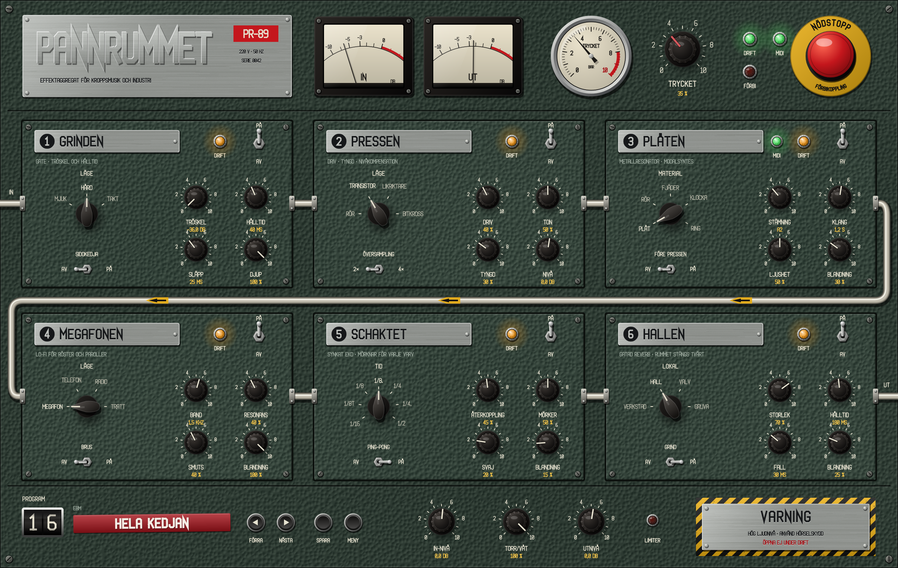
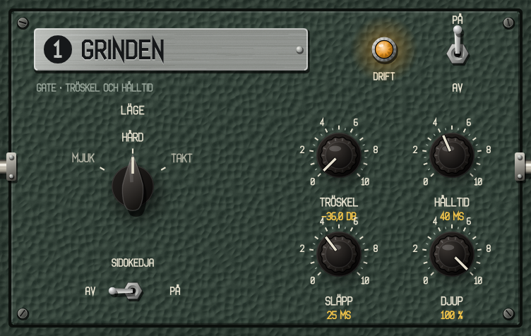
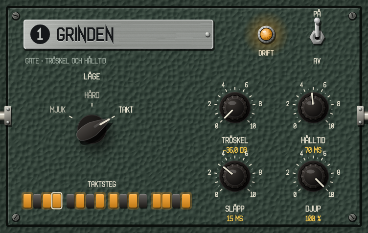
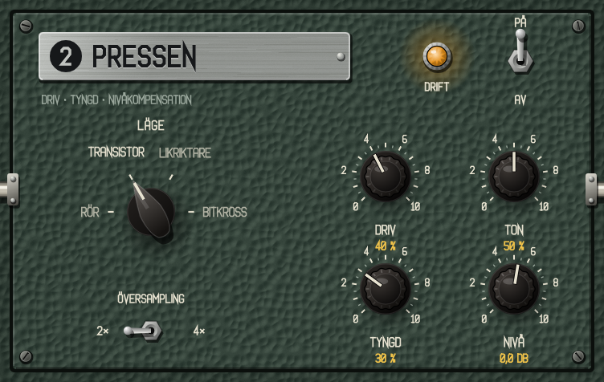
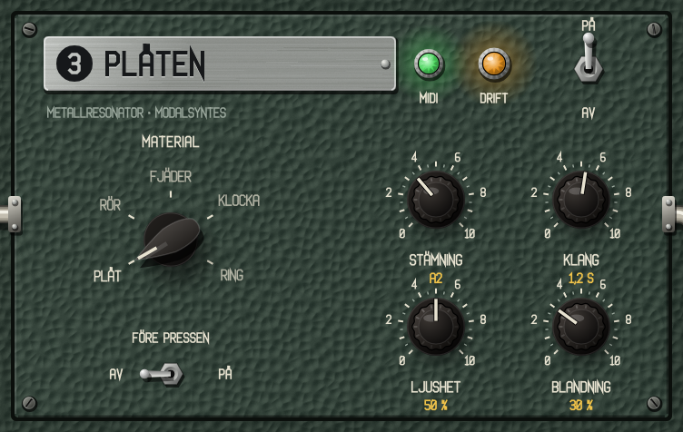
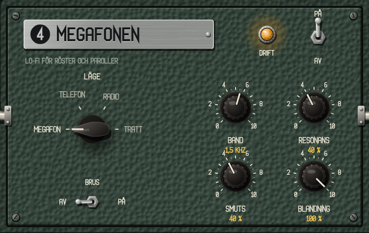
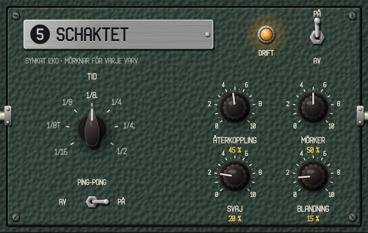
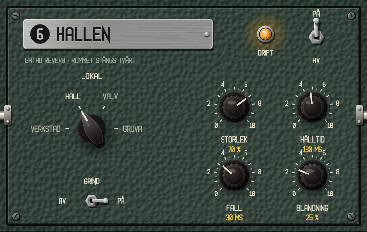
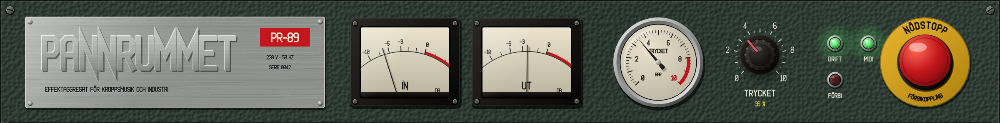
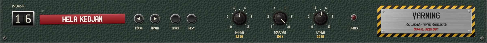

# Pannrummet PR-89 – manual

*Effektaggregat för kroppsmusik och industri.* Pannrummet är en effekt som läggs som insert på ett spår – trummor, bas, stötar, röst eller en hel buss – och gör ett rent ljud till ett EBM- eller industriljud: det grindar, pressar, ger metall, sätter rösten i en megafon och ekar och klingar i schakt och hallar.



**Innehåll:** [Snabbstart](#snabbstart) · [Panelen och reglagen](#panelen-och-reglagen) · [Kedjan](#kedjan) · [1 Grinden](#1-grinden) · [2 Pressen](#2-pressen) · [3 Plåten](#3-plåten) · [4 Megafonen](#4-megafonen) · [5 Schaktet](#5-schaktet) · [6 Hallen](#6-hallen) · [Trycket](#trycket) · [Instrumenten, MIDI och nödstoppet](#instrumenten-midi-och-nödstoppet) · [Utgången](#utgången) · [Programmen](#programmen) · [Recept](#recept) · [Felsökning](#felsökning)

Hur Pannrummet används i Reaper – sidokedja, MIDI, automation och testlåten – står i [Pannrummet i Reaper](Pannrummet_i_Reaper.md).

---

## Snabbstart

1. Lägg **Pannrummet** (VST3) som effekt på ett spår.
2. Klicka på räkneverket eller den röda Dymo-remsan nederst till vänster och välj ett program i den kategori som passar spåret: **Trummor**, **EBM** (bas, stötar, leads, buss), **Röst** eller **Industri**.
3. Spela. Bläddra med **◀ FÖRRA** och **NÄSTA ▶** – programmen ligger ungefär lika starkt som det torra ljudet, så nivån hoppar inte.
4. Vrid på **TRYCKET** (den stora ratten bredvid manometern) för att dra allt mot mer energi.
5. Ändra det du vill, och spara med **SPARA**. Ditt program hamnar under *Egna*.

Vill du börja från noll: välj **01 Init** (allt av) och slå på modulerna en i taget med deras vippor.

---

## Panelen och reglagen

| Reglage | Så gör du |
| --- | --- |
| **Ratt** | Dra upp/ned. Håll **Skift** för fin inställning. Rulla med mushjulet. **Dubbelklick** ger grundvärdet. Värdet står i gult under ratten. |
| **Vridomkopplare** (spetsig ratt med lägen runt om) | **Klick** = nästa läge, **Skift-klick** = förra, rulla, **högerklick** = lista med alla lägen. |
| **Vippa** (förkromad arm) | Klick växlar. Lodrät: **PÅ** uppe, **AV** nere. Vågrät: vänster/höger enligt texten bredvid. |
| **Signallampa som knapp** (MIDI, LIMITER, Grindens taktsteg) | Klick växlar. |
| **Nödstoppet** (röd svamp) | Klick växlar mellan drift och förbikoppling. |
| **Tryckknapparna** nederst | FÖRRA, NÄSTA, SPARA och MENY. |

**MENY** har **Storlek** (60–160 %, 85 % från början; storleken sparas med projektet) och **Visa mappen med egna program**.

---

## Kedjan

```
IN ─▶ 1 GRINDEN ─▶ 2 PRESSEN ─▶ 3 PLÅTEN ─▶ 4 MEGAFONEN ─▶ 5 SCHAKTET ─▶ 6 HALLEN ─▶ TORR/VÅT ─▶ UTNIVÅ ─▶ LIMITER ─▶ UT
```

Röret med de gula pilarna på panelen är signalvägen: genom övre raden från vänster till höger, ned och tillbaka, och genom nedre raden. Plåtens vippa **FÖRE PRESSEN** byter plats på 2 och 3, så att metallen distas i stället för tvärtom.

Varje modul har en **huvudvippa** (PÅ/AV) uppe till höger och en bärnstensfärgad **DRIFT**-lampa som lyser när modulen är på. En avstängd modul räknar inte alls – ingen processorkraft. När en modul med svans (Plåten, Schaktet, Hallen) slås på börjar den från tystnad.

Pannrummet har en fast latens på 38 sample (i 48 kHz), som DAW:en kompenserar automatiskt.

---

## 1 Grinden



En gate: den släpper igenom ljudet när det är starkt nog och stänger när det tystnar. I EBM används den för att hugga av trummor och bas, så att det blir tyst mellan slagen.

| Reglage | Område | Vad det gör |
| --- | --- | --- |
| **LÄGE** | MJUK · HÅRD · TAKT | Se nedan. |
| **TRÖSKEL** | −80 – 0 dB | Hur starkt ljudet måste vara för att grinden ska öppna. Grinden stänger först 4 dB under (hysteres), så att den inte fladdrar. Används inte i TAKT. |
| **HÅLLTID** | 1 – 1000 ms | Hur länge grinden står öppen efter att ljudet gått under tröskeln. I TAKT: hur länge den står öppen från stegets början. |
| **SLÄPP** | 1 – 1000 ms | Hur fort grinden stänger. |
| **DJUP** | 0 – 100 % | 100 % stänger helt. Mindre djup släpper igenom en del (upp till −80 dB), för en mjukare effekt. |
| **SIDOKEDJA** | AV · PÅ | Ett annat spår styr grinden via Pannrummets andra ingång (VST3 och CLAP). Se [Pannrummet i Reaper](Pannrummet_i_Reaper.md#sidokedjan). |

**Lägen:**

- **MJUK** – en vanlig gate: öppnar på 1 ms och stänger mjukt (exponentiellt) på Släpp.
- **HÅRD** – öppnar direkt och stänger rakt på Släpp. Avhugget, som 80-talets trummaskiner genom en gate.
- **TAKT** – tröskeln används inte. Grinden öppnar på de sextondelar du valt, i DAW:ens takt, och står öppen Hålltid. Det hackar vilket ljud som helst i ett mönster – liggande ackord, en hel mix, brus.



I TAKT visas **TAKTSTEGEN** i stället för sidokedjebrytaren: sexton knappar i fyra grupper om fyra, en takt sextondelar. Klick tänder och släcker ett steg. Den vita ramen visar steget som spelas. Står DAW:ens transport still går en egen klocka i projektets tempo.

DRIFT-lampan lyser starkare ju mer grinden är öppen.

> **Tips:** HÅRD med Hålltid 30–50 ms och Släpp 20–40 ms ger den klassiska avhuggna trumman. TAKT med långt Hålltid (100–200 ms) och kort Släpp ger pumpande bas.

---

## 2 Pressen



Distorsionen: kompression före, driv, en formare, ton och nivå. Nivån kompenseras automatiskt, så **DRIV ändrar karaktären, inte volymen**.

| Reglage | Område | Vad det gör |
| --- | --- | --- |
| **LÄGE** | RÖR · TRANSISTOR · LIKRIKTARE · BITKROSS | Formaren, se nedan. |
| **DRIV** | 0 – 100 % | Hur hårt ljudet trycks in i formaren (upp till +36 dB). |
| **TON** | 0 – 100 % | Tilt runt 900 Hz: under 50 % mörkare, över 50 % ljusare (±12 dB i ändarna). |
| **TYNGD** | 0 – 100 % | Kompression före drivet (4:1). Gör att även svaga partier distas – tätare, tyngre. |
| **NIVÅ** | −24 – +12 dB | Utnivå efter nivåkompensationen. |
| **ÖVERSAMPLING** | 2× · 4× | Formaren räknas i 2 eller 4 gånger samplingsfrekvensen. 4× ger renare diskant vid hårt driv men kostar mer. |

**Lägen:**

- **RÖR** – mjuk, asymmetrisk mättnad med jämna övertoner. Varm och rund. Bra på bas.
- **TRANSISTOR** – hårdare, nästan rak klippning. Aggressiv. Bra på trummor och stötar.
- **LIKRIKTARE** – helvågslikriktning blandad med signalen: en oktav upp och smuts. Låter som en trasig förstärkare.
- **BITKROSS** – färre bitar och lägre samplingsfrekvens. Räknas avsiktligt utan översampling: vikningen är ljudet. Driv styr både bitar (16 → 3) och samplingsfrekvens (upp till 16 gånger lägre).

---

## 3 Plåten



En metallresonator: åtta resonatorer stämda efter ett materials deltoner, som ljudet slår an. Trummorna får en plåt att sjunga, basen får ett rör att ringa – Neubauten utan byggarbetsplats.

| Reglage | Område | Vad det gör |
| --- | --- | --- |
| **MATERIAL** | PLÅT · RÖR · FJÄDER · KLOCKA · RING | Se nedan. |
| **STÄMNING** | C1 – C6 | Grundtonen. Med MIDI på: senaste MIDI-ton i stället (se nedan). |
| **KLANG** | 0,05 – 8 s | Efterklangen för grundtonen. Högre deltoner klingar kortare. |
| **LJUSHET** | 0 – 100 % | Mer diskant i anslaget och starkare, längre höga deltoner. |
| **BLANDNING** | 0 – 100 % | Det torra står kvar fullt upp till 50 %; det våta når fullt vid 50 %; över 50 % försvinner det torra. |
| **FÖRE PRESSEN** | AV · PÅ | Flyttar Plåten före Pressen. |
| **MIDI** (grön lampa) | av · på | Plåten följer inkommande MIDI-toner. Fungerar bara när huvudbrytaren **MIDI** överst också är på. |

**Material:**

- **PLÅT** – tät, oharmonisk, som en stålplatta.
- **RÖR** – nästan harmonisk, lätt sträckt: ett öppet rör eller en balk.
- **FJÄDER** – glesa deltoner där toppen dör fort.
- **KLOCKA** – klockans deltoner: brum en oktav under, grundton, ters, kvint, nominal.
- **RING** – en ringmodulator: ljudet gånger en bärvåg på grundtonen. Här gör Ljushet bärvågen fyrkantigare och Klang lägger en kort kamresonans på bärvågens period. Robotröster och metalliska basar.

> **Tips:** Stäm Plåten till låtens tonart. Med MIDI kan den följa basgången – lägg ett MIDI-objekt med basens toner på spåret och slå på båda MIDI-lamporna.

---

## 4 Megafonen



Lo-fi för röster och paroller: ett smalt band, en liten högtalare som bryter upp och – om man vill – en dålig ledning.

| Reglage | Område | Vad det gör |
| --- | --- | --- |
| **LÄGE** | MEGAFON · TELEFON · RADIO · TRATT | Se nedan. |
| **BAND** | 200 – 5000 Hz | Mittfrekvensen som varje läge bygger sitt filter runt. |
| **RESONANS** | 0 – 100 % | Hur mycket toppen vid Band sticker ut, och hur mycket hornet ringer. |
| **SMUTS** | 0 – 100 % | Hur hårt högtalaren bryter upp. I TELEFON också färre bitar. |
| **BLANDNING** | 0 – 100 % | Från torrt till bara megafon. |
| **BRUS** | AV · PÅ | Ledningsbrus och sprak (mest i RADIO). Brus hörs även när ingången är tyst. |

**Lägen:**

- **MEGAFON** – bandpass med topp, hårt klippande liten högtalare och en kort hornresonans. Paroller.
- **TELEFON** – 300–3400 Hz, 8 kHz samplingsfrekvens och µ-lag.
- **RADIO** – bredare band som svajar långsamt, som dålig mottagning.
- **TRATT** – en smal lur med två resonanstoppar och kraftig kamfiltrering.

Nivån kompenseras automatiskt.

---

## 5 Schaktet



Ekot, i DAW:ens tempo. Varje varv blir mörkare och smutsigare, som ett bandeko eller ett BBD-eko.

| Reglage | Område | Vad det gör |
| --- | --- | --- |
| **TID** | 1/16 · 1/8T · 1/8 · 1/8. · 1/4 · 1/4. · 1/2 | Ekotiden i noter (T = triol, punkt = punkterad). Följer tempot. Tidsbyten glider utan klick. |
| **ÅTERKOPPLING** | 0 – 95 % | Hur mycket av ekot som går tillbaka in – antalet upprepningar. |
| **MÖRKER** | 0 – 100 % | Lågpass i återkopplingen, från 12 kHz ned till 700 Hz: varje varv mörkare. |
| **SVAJ** | 0 – 100 % | Långsam modulation av tiden (upp till 4 ms), som slitet band. |
| **BLANDNING** | 0 – 100 % | Som i Plåten: det torra står kvar fullt upp till 50 %. |
| **PING-PONG** | AV · PÅ | Ekot studsar mellan vänster och höger. |

Ett högpass vid 120 Hz i återkopplingen håller basen ren.

---

## 6 Hallen



Den gatade reverben – virvelns signaturljud – och ett rum som kan klinga ut fritt.

| Reglage | Område | Vad det gör |
| --- | --- | --- |
| **LOKAL** | VERKSTAD · HALL · VALV · GRUVA | Rummets karaktär, se nedan. |
| **STORLEK** | 0 – 100 % | Rummets storlek och efterklang (0,3–6 s, längre i Valv och Gruva). |
| **HÅLLTID** | 10 – 1000 ms | Med GRIND: hur länge rummet står öppet efter att ljudet tystnat. |
| **FALL** | 5 – 2000 ms | Med GRIND: hur fort rummet stängs efter Hålltid. |
| **BLANDNING** | 0 – 100 % | Som i Plåten: det torra står kvar fullt upp till 50 %. |
| **GRIND** | AV · PÅ | PÅ: rummet öppnas när ljudet kommer (över −40 dBFS) och stängs tvärt efter Hålltid + Fall. AV: rummet klingar ut. |

**Lokaler:**

- **VERKSTAD** – litet, ljust, täta reflexer.
- **HALL** – stort och jämnt.
- **VALV** – sten: långt, mörkt, mullrande.
- **GRUVA** – metalliskt, svajande, mycket långt.

Ett högpass vid 150 Hz på ingången håller bastrumman ute ur rummet.

> **Tips:** Den klassiska gatade virveln: HALL eller VALV, Storlek 70–90 %, GRIND på, Hålltid 150–250 ms, Fall 20–40 ms, Blandning 40–50 %.

---

## Trycket

**TRYCKET** är makrospaken: den drar alla påslagna moduler mot mer energi samtidigt. Manometern visar trycket; ratten bredvid ställer det (det går också att dra i manometern).

| Modul | Vid fullt tryck |
| --- | --- |
| Grinden | Tröskeln +10 dB, Hålltid −40 %, Släpp −60 % – hårdare |
| Pressen | Driv +50 %, Tyngd +40 % |
| Plåten | Klang ×2, Blandning +30 % |
| Megafonen | Smuts +50 % |
| Schaktet | Återkoppling +25 %, Blandning +20 % |
| Hallen | Storlek +30 %, Blandning +20 % |

Avstängda moduler påverkas inte. Rattarna på panelen visar dina inställningar; Trycket läggs ovanpå. Automatisera Trycket för uppbyggen.

---

## Instrumenten, MIDI och nödstoppet



- **IN** och **UT** – visarinstrument för nivån in och ut (−20 till +3 dB, rött över 0).
- **Manometern** – Trycket.
- **DRIFT** (grön) – lyser när Pannrummet arbetar. **FÖRBI** (röd) – lyser när nödstoppet är intryckt.
- **MIDI** (grön lampa, klicka för att växla) – MIDI in för hela Pannrummet. **Av från början.** Av: Pannrummet struntar i alla MIDI-toner och Plåten följer sin ratt – så kan du ha MIDI på spåret och byta program utan att något sätter igång. På: tonerna når Plåten (om Plåtens egen MIDI-lampa också är tänd).
- **NÖDSTOPPET** – kopplar förbi hela Pannrummet: ljudet tonas över på 20 ms till det helt obehandlade ljudet (bitexakt, med samma latens). DAW:ens bypass-knapp är samma sak.

---

## Utgången



| Reglage | Område | Vad det gör |
| --- | --- | --- |
| **IN-NIVÅ** | −24 – +24 dB | Nivån in i kedjan. Mer in = hårdare grind- och pressbeteende. |
| **TORR/VÅT** | 0 – 100 % | Blandar hela kedjan med det torra ljudet (parallell bearbetning). |
| **UTNIVÅ** | −24 – +12 dB | Nivån ut. |
| **LIMITER** (röd lampa) | – | Toppbegränsare sist i kedjan, tak −0,3 dBFS. Lampan lyser när den tar i. Klicka på lampan för att stänga av eller slå på limitern. |

---

## Programmen

Nederst till vänster: räkneverket visar programnumret, Dymo-remsan namnet och texten ovanför kategorin.

- **◀ FÖRRA / NÄSTA ▶** – bläddrar.
- **Klick på räkneverket eller remsan** – listan, en undermeny per kategori.
- **SPARA** – sparar nuvarande inställning som ett eget program. Det hamnar under *Egna* och sparas som en fil i `~/Library/Application Support/Pannrummet/Program/`. MENY → *Visa mappen med egna program* öppnar mappen; där kan du byta namn på eller ta bort program, och dela dem med andra.
- Ett program sätter **alla** reglage – det programmet inte nämner går till grundvärdet – men **aldrig** NÖDSTOPPET eller MIDI.
- DAW:ens presetmeny visar fabriksbandet.

Fabriksbandet – 30 program – finns i tabellen i [README](../README.md#programmen). Lyssna på dem i `renders/program/`.

---

## Recept

**Gatad EBM-virvel** – på virvelspåret: program *02 Gatad virvel*. Mer rum: höj Hallens Storlek. Kortare: sänk Hålltid.

**Bas som pumpar mot bastrumman** – på basspåret: Grinden HÅRD, SIDOKEDJA på, bastrumman skickad till sidokedjan (se [Reaper-manualen](Pannrummet_i_Reaper.md#sidokedjan)). Eller utan sidokedja: program *12 Pumpande bas* (Grinden i TAKT på offbeats).

**Två basar i lager** – den mörka basen: *10 Kolvbas*. Den ljusa: *11 Distad bas 2*. Panorera isär, eller låt dem mötas i mitten.

**Paroller** – rösten: *19 Megafon*. Mer rymd: *20 Paroll i schaktet*. Byt till RADIO med brus i en break för kontrast.

**Neubauten-trummor** – metallslag eller vanliga trummor: *04 Stålverkstad* eller *26 Ras i schaktet*. Stäm Plåten till låtens grundton.

**Robotröst som följer melodin** – *24 Robotröst*, slå på **MIDI** överst, och lägg ett MIDI-objekt med melodin på röstspåret.

**Uppbygge** – automatisera **TRYCKET** från 0 till 70 % över fyra eller åtta takter och släpp tillbaka på ettan.

---

## Felsökning

| Problem | Lösning |
| --- | --- |
| Inget ljud går igenom | Kontrollera att **FÖRBI**-lampan är släckt och att IN-instrumentet rör sig. Rör det sig inte kommer inget ljud in – kontrollera spårets ruttning. Använd **VST3**-versionen i Reaper. |
| Jag hör ingen skillnad | Är modulens vippa på PÅ och lyser DRIFT? Är **TORR/VÅT** uppe? Blandning i Plåten, Schaktet och Hallen är 25–35 % från början – vrid upp. |
| Plåten följer inte MIDI | Både **MIDI** överst och Plåtens **MIDI**-lampa måste lysa, och spåret måste ha MIDI (eller få MIDI skickat). |
| Grinden i TAKT står still | I DAW:en följer den transporten; står transporten still går den på egen klocka i projektets tempo. Kontrollera att några taktsteg är tända. |
| Det låter för starkt | Limitern tar topparna, men sänk **UTNIVÅ** eller **IN-NIVÅ**. Höga Klang- och Återkopplingsvärden bygger upp energi. |
| Programbyte nollställde mina ändringar | Ett program sätter alla reglage. Spara dina ändringar med **SPARA** först. |
| Brus fast inget spelas | Megafonens **BRUS** är på. |
